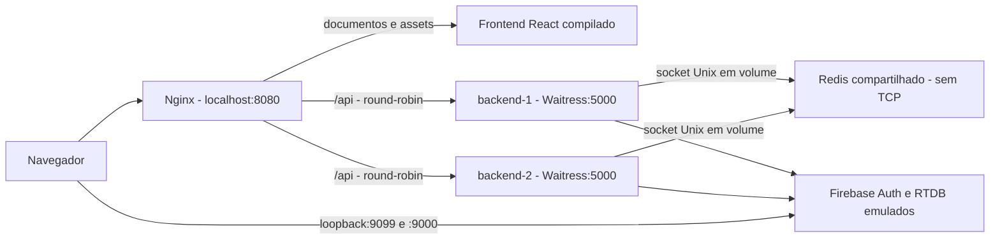

# Contêineres e balanceamento de carga — passo a passo

Esta entrega inclui Dockerfiles para backend e frontend e um `compose.yaml` com duas instâncias da API atrás de Nginx. O ambiente usa Firebase emulado e projeto fictício `demo-coursesphere`: funciona sem conta de serviço, credenciais reais ou chave de IA. O fluxo de consultas continua retornando a implementação de demonstração da aplicação.

## 1. Arquitetura implementada



| Serviço | Função | Acesso pelo host |
| --- | --- | --- |
| `gateway` | Nginx; frontend em `/`, duas APIs em `/api/` | `http://127.0.0.1:8080` |
| `frontend` | Build React/Vite servido por Nginx com usuário sem privilégios | Sem porta publicada |
| `backend-1` | Um processo Waitress com quatro threads; identidade `backend-1` | Sem porta publicada |
| `backend-2` | A mesma imagem, processo independente; identidade `backend-2` | Sem porta publicada |
| `redis` | Cotas compartilhadas entre as APIs via socket Unix | Sem rede TCP e sem porta publicada |
| `firebase-emulators` | Authentication e Realtime Database para desenvolvimento | Apenas loopback: `9099` e `9000` |

Os backends usam o mesmo Firebase e o mesmo Redis. Não há estado de sessão local em cada réplica nem necessidade de sessão fixa no balanceador: o ID token Firebase acompanha a requisição. O segredo de métricas é montado em arquivo com Compose secrets, sem entrar na imagem.

O uso de `redis+unix:///run/redis/redis.sock` é suportado pelo [backend Redis do limits](https://limits.readthedocs.io/en/stable/storage.html). O volume do socket é montado somente no Redis e nas duas APIs, em modo somente leitura nas APIs. O socket aceita conexão de seus consumidores pelo volume; a proteção depende dessa restrição de montagem. O Redis não aceita conexões TCP. A política anterior que exige TLS para Redis remoto continua válida.

## 2. Pré-requisitos

No Windows, use Docker Desktop iniciado com contêineres Linux e Docker Compose v2 ou posterior. A primeira construção baixa imagens, pacotes Python/npm e o emulador Java; precisa de internet e espaço livre. Os limites configurados somam cerca de 2,4 GiB, além da memória do Docker e das construções; reserve recursos compatíveis.

Na raiz do repositório:

```powershell
docker version
docker compose version
```

`docker version` deve mostrar **Client e Server**. Se aparecer somente Client com erro de conexão, inicie o Docker Desktop e aguarde o engine. Não execute os emuladores locais antigos ao mesmo tempo: eles usam as mesmas portas `9099` e `9000`.

## 3. Preparar o segredo e construir

Ainda na raiz, execute:

```powershell
powershell -NoProfile -ExecutionPolicy Bypass -File scripts/initialize-docker.ps1
docker compose config --quiet
docker compose build backend-1 frontend firebase-emulators
docker compose up -d --wait --wait-timeout 180 --no-build
docker compose ps
```

O script cria um token aleatório em `.tools/docker/metrics-token.txt`, ignorado pelo Git. Uma segunda execução preserva o segredo existente e valida seu formato. Não imprime seu valor. O Compose precisa desse arquivo antes de iniciar as APIs. Não publique o resultado de `docker compose config` de configurações que tenham credenciais em variáveis de ambiente; `--quiet` basta para validar esta configuração.

Construir `backend-1` é suficiente para ambas as réplicas, que usam a mesma imagem `coursesphere-backend:local`. O frontend recebe `VITE_USE_FIREBASE_EMULATORS=true` em build time. O Dockerfile continua usando `false` por padrão para construções independentes; o valor seleciona tanto o bundle Firebase quanto a CSP apropriada ao ambiente. Nenhum `.env` é copiado para a imagem.

`depends_on` usa `condition: service_healthy`: as APIs esperam Redis e emuladores; o gateway espera as APIs e o frontend. Essa ordenação e os healthchecks seguem o [modelo de inicialização do Docker Compose](https://docs.docker.com/compose/how-tos/startup-order/). Ela não substitui supervisão ou readiness completa das dependências durante toda a execução.

Abra **http://127.0.0.1:8080**, cadastre uma conta de teste e faça login. A página chama `/api/...` na mesma origem, e o gateway remove `/api/` ao encaminhar a requisição. O SDK Firebase do navegador acessa os emuladores publicados no loopback do host; o SDK do backend acessa o serviço `firebase-emulators` pela rede Docker.

### Verificações rápidas

```powershell
curl.exe -i http://127.0.0.1:8080/api/health
curl.exe -i http://127.0.0.1:8080/api/users/info
curl.exe -i http://127.0.0.1:8080/api/metrics
```

Resultados esperados: `200` para a sonda de vida, `401` para perfil sem Bearer e `404` para métricas no gateway público. `/health` continua sendo liveness, sem afirmar que Firebase e Redis estão saudáveis. Cada resposta efetivamente atendida pela API inclui `X-Backend-Instance` e `X-Request-ID`.

## 4. Demonstrar a distribuição entre instâncias

Com Node.js instalado no host:

```powershell
node scripts/check-load-balancing.mjs
```

O script faz oito chamadas HTTP reais a `/api/health`, valida os headers e exige que **as duas identidades** apareçam. Também verifica frontend, asset JavaScript, autenticação e bloqueio de métricas no gateway. Salva a evidência sanitizada em `docs/evidence/docker-load-balancing.json`.

Alternativa manual, sem Node.js:

```powershell
1..8 | ForEach-Object {
    $response = Invoke-WebRequest http://127.0.0.1:8080/api/health
    "request=$_ status=$($response.StatusCode) instance=$($response.Headers['X-Backend-Instance']) request_id=$($response.Headers['X-Request-ID'])"
}
```

O Nginx usa pesos iguais e round-robin com estado de upstream compartilhado entre seus workers, conforme a [documentação oficial de balanceamento](https://nginx.org/en/docs/http/load_balancing.html). Sondagens de saúde e outros acessos também participam da distribuição: não é correto exigir alternância estrita para a sequência vista por um cliente, ou exatamente 50% em uma amostra pequena. A verificação exige atendimento pelas duas réplicas.

Consulte os logs de atendimento:

```powershell
docker compose logs --no-color --tail 30 gateway backend-1 backend-2
```

No gateway, o evento `gateway_request` informa `instance`, `request_id`, rota normalizada e status. Na API, `request_completed` tem os mesmos valores de instância e correlação. O gateway não fabrica a identidade: usa o header devolvido pelo backend. A configuração da API valida o identificador e não aceita um valor fornecido pelo cliente como sua própria identidade.

## 5. Validar Firebase e a cota compartilhada

Para a verificação completa:

```powershell
npm run test:containers
```

Esse comando também:

1. Cria uma conta temporária exclusivamente no emulador de Authentication.
2. Salva um perfil via API e comprova que ambas as instâncias leem o mesmo conteúdo do RTDB.
3. Envia 22 consultas com o mesmo usuário: espera 20 respostas `200` e duas `429`, distribuídas entre as instâncias. Duas cotas independentes em memória permitiriam mais de 20 chamadas; o teste detectaria essa regressão.
4. Remove os dados e a conta temporária ao encerrar o cenário funcional, sem afetar outras contas.
5. Atualiza a evidência JSON sem registrar token, senha, e-mail, UID ou corpo do perfil.

As chamadas consomem a cota de IP compartilhada. Aguarde a janela de um minuto antes de repetir o cenário muitas vezes ou de retomar testes manuais intensivos. Tokens de autenticação não aparecem no comando nem na evidência. O uso de `auth=` na limpeza é específico do protocolo REST do emulador; a API da aplicação continua recusando tokens na URL.

## 6. Cuidados incorporados à implementação

- O backend executa **Waitress**, sem Flask debug, em um processo por contêiner. As métricas de cada réplica podem ser coletadas separadamente.
- Backend e frontend executam com usuários sem privilégios; há sistema de arquivos somente leitura, diretórios temporários em tmpfs e restrições de capacidades nos serviços da aplicação.
- Contextos de build excluem credenciais, ambientes virtuais, `.env`, dados locais e dependências do host. O backend e o contexto dos emuladores usam listas explícitas de arquivos permitidos; a imagem final do frontend recebe somente os arquivos compilados e configurações Nginx.
- As APIs não publicam portas. O Waitress confia somente no IP fixo do gateway (`172.30.90.10`) para `X-Forwarded-For` e `X-Forwarded-Proto`. O gateway **sobrescreve** esses headers com o peer observado e o esquema da conexão. Um header enviado pelo cliente não pode escolher sua chave de cota ou inventar HTTPS.
- A rede Docker usa a faixa `172.30.90.0/24`. Se houver conflito com outra rede/VPN, altere conjuntamente a subnet, o IP de `gateway` e `COURSESPHERE_TRUSTED_PROXY` no Compose. Não use `*` para confiar em qualquer proxy.
- `/api/metrics`, inclusive aliases normalizados testados, é bloqueado no gateway. Para coleta privada, use `backend-1:5000/metrics` e `backend-2:5000/metrics`, com o segredo de arquivo. Prometheus precisa alcançar a rede de aplicação; não colete através do balanceador, pois cada processo tem seus próprios contadores.
- O Nginx usa o DNS interno do Docker para resolver novamente os serviços quando seus IPs mudam. A configuração não adiciona reenvio de operações não idempotentes nem retry automático de respostas de aplicação `500/503`.
- Logs de acesso Nginx são JSON e omitem URL bruta, query string, corpos e cabeçalhos de autenticação. Erros do Nginx ficam limitados a nível crítico; diagnósticos operacionais usam status, correlação e instância dos logs de acesso. A política dos logs da aplicação permanece em [observability.md](observability.md).

O mount de Compose secrets disponibiliza arquivos a serviços autorizados, conforme a [documentação de segredos do Compose](https://docs.docker.com/compose/how-tos/use-secrets/). Isso não equivale a afirmar criptografia dos arquivos no host: a proteção do host e do armazenamento local continua necessária.

## 7. Operação e limites

```powershell
docker compose ps
docker compose logs --tail 50 backend-1 backend-2 gateway
docker compose stop
docker compose start
```

`stop` preserva contêineres e volumes. Para remover os contêineres e a rede desta composição, preservando os volumes:

```powershell
docker compose down
```

Os dados dos emuladores ficam no volume `firebase_data`, com importação e exportação no encerramento normal. O volume `redis_socket` contém o socket compartilhado; a configuração do Redis não persiste as cotas. Reiniciar o Redis reinicia os contadores. O Compose não transforma esse Redis único em armazenamento de alta disponibilidade.

**Não use `down -v` para uma parada comum:** essa opção remove também os volumes com dados do ambiente. Não é necessária para esta demonstração.

Este é um ambiente de desenvolvimento/demonstração no host local. Não exponha os emuladores à internet nem altere as portas para `0.0.0.0` para publicar a aplicação. Uma implantação real precisa de Firebase real, credencial montada como segredo, `COURSESPHERE_LOCAL=0`, frontend compilado sem modo emulador, HTTPS no gateway, HSTS e políticas de rede/segredos adequadas ao ambiente. Os Dockerfiles podem ser reutilizados com essas configurações; este Compose deliberadamente fornece o modo local reproduzível.

Imagens base usam tags oficiais de série (`python:3.13-slim`, `node:24-*`, `nginx:stable-alpine`, `redis:8-alpine`, `eclipse-temurin:21-jre-jammy`). Uma reconstrução futura pode receber atualizações dessas tags e dependências transitivas; para promoção controlada, registre os digests, audite as imagens e fixe os artefatos aprovados. Não foi alegado scan completo de vulnerabilidades dos pacotes do sistema operacional das imagens.

## 8. Resultados executados, evidências e commits

Os seis serviços foram construídos/iniciados com Docker Desktop em modo Linux e ficaram saudáveis. `nginx -t` passou no gateway e no frontend. A demonstração executada enviou oito chamadas `200`: **quatro atendidas por `backend-1` e quatro por `backend-2`**. Os oito IDs foram encontrados tanto no log do gateway quanto no log da API correspondente.

Trecho da saída real, com os IDs completos no arquivo de evidência:

```text
request=1 status=200 instance=backend-1
request=2 status=200 instance=backend-2
request=3 status=200 instance=backend-1
request=4 status=200 instance=backend-2
shared_profile=ok shared_redis_quota=20 accepted, 2 rejected across both instances
```

O teste funcional confirmou perfil compartilhado e cota Redis de 20 consultas por UID entre as duas APIs. A suíte do backend passou em **57 testes, sem falhas, erros ou skips**, incluindo seis testes novos de configuração e integração com os emuladores do Compose. A auditoria do ambiente Python instalado não encontrou vulnerabilidades conhecidas, e `pip check` passou. As três imagens da aplicação foram construídas; o build do frontend concluiu TypeScript e Vite, com aviso de bundle acima de 500 kB, que não impede a execução. Não houve teste de carga ou ataque em navegador.

O primeiro smoke test revelou duplicação de headers de segurança entre gateway e upstream; a configuração foi corrigida para entregar uma única cópia de `X-Frame-Options`, `X-Content-Type-Options` e `Referrer-Policy` no gateway. A demonstração final passou após a correção.

As evidências desta etapa ficam em `docs/evidence/`:

- [docker-load-balancing.txt](evidence/docker-load-balancing.txt): saída real com instâncias diferentes atendendo requisições.
- [docker-load-balancing.json](evidence/docker-load-balancing.json): resultados HTTP, perfil e cotas, sem credenciais.
- [docker-runtime.json](evidence/docker-runtime.json): seis serviços saudáveis, UIDs sem privilégios de backend/frontend, arquivos excluídos da imagem e correlação dos oito requests nos logs.
- [container-tests.json](evidence/container-tests.json): 57 testes do backend aprovados.
- [pip-audit-containers.json](evidence/pip-audit-containers.json): auditoria do ambiente Python instalado após incluir Waitress.

O arquivo de demonstração é atualizado ao repetir o script; os relatórios históricos das etapas anteriores permanecem separados. A auditoria do ambiente Python não equivale a um scan dos pacotes de sistema das imagens.

Logs brutos de construção/depuração e o segredo ficam somente em `.tools/`, fora do Git. Resultados executados e eventuais limites de validação devem ser lidos junto das evidências, sem inferir desempenho de produção ou garantia de disponibilidade a partir de oito chamadas.
